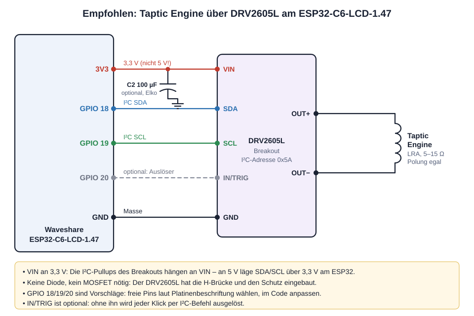
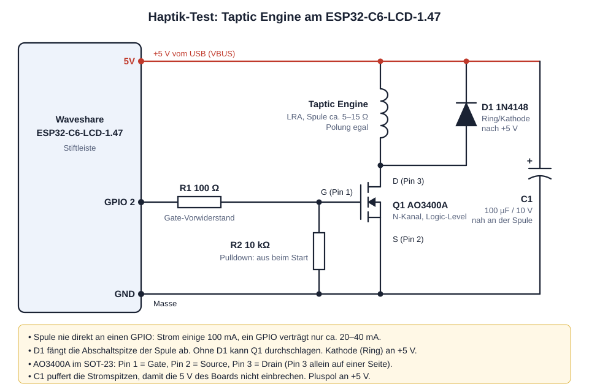

# Waveshare ESP32-C6 1.47"

Projekte für das Waveshare **ESP32-C6-LCD-1.47** (172 × 320, ST7789, 4 MB Flash, RGB-LED).

## Flitz hüpft

Ein Jump'n'Run im Querformat. Flitz läuft von allein, die Welt wird zufällig erzeugt.

- **BOOT-Taste kurz tippen:** kleiner Sprung
- **BOOT-Taste halten:** hoher Sprung
- Münzen: 10 Punkte, Stachelkugel von oben: 25 Punkte, jeder Meter: 1 Punkt
- Der Rekord bleibt nach dem Ausschalten erhalten (NVS).
- RGB-LED: gelb = Münze, grün = Treffer, rot = Game Over

## Haptik-Test (Taptic Engine)

> **Seitenbranch:** Der Haptik-Test lebt nur auf `feat/haptik-test` und wird **nie nach `main` gemergt** (kein PR).

Testprogramm für eine iPhone-Taptic-Engine (LRA) als Vorstufe für die Tasten-Haptik am Modellaufzug.
Es ersetzt beim Flashen das Spiel; zurück geht es mit `pio run -t upload`.

```
pio run -e haptik_test -t upload
```

### Schaltung

Empfohlen ist der Haptik-Treiber **DRV2605L** (Auto-Kalibrierung, aktives Bremsen, fertige Effekte).
Das Testprogramm steuert bisher die einfache MOSFET-Variante; die DRV2605L-Firmware folgt.



Einfache Variante mit MOSFET:



Zum Ausdrucken: [docs/haptik-anleitung.pdf](docs/haptik-anleitung.pdf) – Seite 1–2 empfohlene Variante mit **DRV2605L**,
Seite 3–4 einfache MOSFET-Variante, jeweils mit Schaltplan, Bauteilen, Aufbau und Fehlersuche
(Quelle `docs/haptik-anleitung.html`, PDF mit Edge „Drucken → Als PDF speichern“ neu erzeugen).

Die Spule hat nur wenige Ohm und darf **nie direkt an einen GPIO**. Ein Logic-Level-MOSFET schaltet sie an 5 V.

| Teil | Wert / Typ | Anschluss |
|---|---|---|
| Q1 | AO3400A (N-Kanal, SOT-23) oder IRLML6244 | Pin 1 Gate, Pin 2 Source → GND, Pin 3 Drain → Spule |
| R1 | 100 Ω | GPIO 2 → Gate |
| R2 | 10 kΩ | Gate → GND (hält Q1 beim Start aus) |
| D1 | 1N4148 (oder 1N5819) | parallel zur Spule, Kathode/Ring an +5 V |
| C1 | 100 µF / ≥ 10 V Elko | +5 V → GND, nah an der Spule, Plus an +5 V |
| Spule | iPhone-7/8-Taptic-Engine | zwischen +5 V und Drain, Polung egal |

Die Spulenpins am Flex mit dem Multimeter suchen: wenige Ohm zwischen zwei Kontaktgruppen, untereinander
verbundene Kontakte gehören zum selben Anschluss. Der SOT-23 ist winzig; ein kleines SOT-23-Adapterplatinchen
macht das Löten leichter.

### Bedienung (BOOT-Taste)

| Eingabe | Wirkung |
|---|---|
| jeder Druck | Klick bzw. Brummen auslösen |
| halten (> 0,6 s) | Frequenz +10 Hz, läuft weiter solange gehalten (100–300 Hz, danach wieder 100) |
| zweimal schnell | Modus: Klick 2 / 3 / 5 Perioden, Brummen 0,4 s |

Ziel: die Frequenz finden, bei der es am stärksten klickt (Resonanz). Am besten im Modus *Brummen* suchen,
danach im Modus *Klick* das Gefühl prüfen. Frequenz und Modus bleiben gespeichert, die serielle
Ausgabe (115200 Baud) zeigt jeden Puls.

## Bauen und Flashen

Voraussetzung: PlatformIO (pioarduino, Arduino-ESP32 3.3).

```
pio run -t upload
```

Falls der Upload nicht startet: BOOT gedrückt halten, kurz RESET drücken, BOOT loslassen.

## Pins

| Funktion | GPIO |
|---|---|
| LCD MOSI / SCLK | 6 / 7 |
| LCD CS / DC / RST | 14 / 15 / 21 |
| Hintergrundlicht (PWM, ~50 %) | 22 |
| RGB-LED (WS2812) | 8 |
| BOOT-Taste | 9 |
| Haptik (nur Haptik-Test, Gate MOSFET) | 2 |

## Branch-Namen

Nur zweistufig `präfix/name`, z. B. `feat/flitz-huepft`. Einmal pro Klon: `tools\git_hooks_einrichten.bat`.
